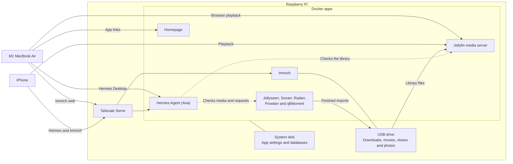

# 🎬 Rajin's Homelab & Media Automation Stack

> 🍓 I moved the homelab to a **Raspberry Pi 5** after the old Mac setup stopped working. The Pi keeps the apps running when the MacBook Air is closed.
>
> 🎞️ **[Jellyfin](https://github.com/jellyfin/jellyfin)** is my own private Netflix for the movies and shows I keep on the Pi. I open it in a browser on the Mac and watch the same library on the iPhone.
>
> 🤖 **Aria** is what I call my [Hermes](https://github.com/NousResearch/hermes-agent) agent. If I want to know what's running or where a request went, that's where I start.

📖 **Building something similar?** Start with the [Homelab Reading Order & Setup Checklist](ReadingOrder.md). If you want the agent to do most of the setup, there's a [prompt you can paste into Hermes](Hermes.md).

---

## 📦 Stack Overview

| Tool | What it does |
| --- | --- |
| 🎞️ **[Jellyfin](https://github.com/jellyfin/jellyfin)** | Your own streaming library for movies and shows |
| 🍿 **[Jellyseerr](https://github.com/seerr-team/seerr)** | A place to browse and request a movie or show |
| 📺 **[Sonarr](https://github.com/Sonarr/Sonarr)** | Finds and organizes TV episodes |
| 🎬 **[Radarr](https://github.com/Radarr/Radarr)** | Finds and organizes movies |
| 🔍 **[Prowlarr](https://github.com/Prowlarr/Prowlarr)** | One list of places your movie and TV apps look for files |
| ⬇️ **[qBittorrent](https://github.com/qbittorrent/qBittorrent)** | Downloads files and can share them with other people |
| 🤖 **[Hermes Agent](https://github.com/NousResearch/hermes-agent)** | A chat assistant I can ask to check or help set up the Pi |
| 🏡 **[Homepage](https://github.com/gethomepage/homepage)** | One page for app shortcuts, what's playing, and how much space is left |
| 📸 **[Immich](https://github.com/immich-app/immich)** | My own private Google Photos, with the library on my USB drive |
| 🔒 **[Tailscale](https://github.com/tailscale/tailscale)** | My own private VPN for reaching the Pi away from home |

[Jellyseerr](https://github.com/seerr-team/seerr) is the app still running on the Pi. Its upstream project is now called [Seerr](https://github.com/seerr-team/seerr). The [Media Automation Guide](Automation.md) covers the connections if you're setting up either one.

---

## 🧭 File Structure

The Pi has **16 GB of RAM** and runs **64-bit Debian 13**. App settings and databases stay on the system disk. The **1 TB USB drive** holds the big files.

```text
/srv/media/
├── Aria-Downloads/     Downloads
├── Aria-Inbox/
│   ├── Movies/         Movie library
│   └── TV/             TV library
└── Immich/             Photos and videos
```

The media folders brought over from the Mac live on the USB drive too. The [Jellyfin Setup Guide](Jellyfin.md) shows where both sets of folders appear inside the app.

---

## 🗺️ How Everything Fits Together



---

## 🚀 How a Movie or Show Gets to the Library

1. **Request it.** Open [Jellyseerr](https://github.com/seerr-team/seerr) or ask your agent to help find the title.
2. **Find a match.** [Radarr](https://github.com/Radarr/Radarr) handles movies and [Sonarr](https://github.com/Sonarr/Sonarr) handles TV. They search the sources set up through [Prowlarr](https://github.com/Prowlarr/Prowlarr).
3. **Download and import.** [qBittorrent](https://github.com/qbittorrent/qBittorrent) saves the file on the USB drive. [Radarr](https://github.com/Radarr/Radarr) or [Sonarr](https://github.com/Sonarr/Sonarr) puts the finished file in its library folder.
4. **Hit play.** [Jellyfin](https://github.com/jellyfin/jellyfin) scans that folder and shows the title in the library.

> 💡 For the [automation checklist](Automation.md), pick a title that's in the request catalog and available from a source you're allowed to download from. A video you made works for testing [playback on its own](Jellyfin.md).

If a request is approved and the title still isn't in the library, I'll ask Aria, “Where did that request get stuck?” The [Hermes Guide](Hermes.md) shows how I use the agent to check which app is waiting and how to give it this repo to help set up a fresh Pi.

---

## 🌐 What I Open on the iPhone and MacBook Air

| What I want to do | iPhone | M1 MacBook Air |
| --- | --- | --- |
| 🎬 Watch the library | [Moonfin](https://github.com/Moonfin-Client/Moonfin-Core) | [Jellyfin](https://github.com/jellyfin/jellyfin) in a browser |
| 🤖 Talk to Aria | [Hermex](https://github.com/uzairansaruzi/hermex) | [Hermes Desktop](https://github.com/NousResearch/hermes-agent/tree/main/apps/desktop) |
| 📸 Browse photos | [Immich](https://github.com/immich-app/immich) app, which also uploads selected albums | [Immich](https://github.com/immich-app/immich) in a browser |
| 🏡 Open the other apps | Browser when I need one | [Homepage](https://github.com/gethomepage/homepage) for the shortcuts |

The [Tailscale Setup Guide](Tailscale.md) shows how I reach the Pi when I'm away. The [App Addresses & Ports](Access.md) page has what I enter in each app.

---

## 👋 What's Gone Since the Mac Setup?

- **[Uptime Kuma](https://github.com/louislam/uptime-kuma).** I got tired of the constant emails. Now I glance at [Homepage](https://github.com/gethomepage/homepage) or ask Aria if something seems off. [Why I Took Uptime Kuma Out](UptimeKuma.md)
- **[Transmission](https://github.com/transmission/transmission).** [qBittorrent](https://github.com/qbittorrent/qBittorrent) took over downloads when the stack moved to the Pi. [Media Automation Guide](Automation.md)
- **The old [Homepage](https://github.com/gethomepage/homepage) script and Mac cron jobs.** [Homepage](https://github.com/gethomepage/homepage) runs in Docker. The Pi has its own timers, and [Hermes](https://github.com/NousResearch/hermes-agent) handles the scheduled messages. [Homepage Guide](Homepage.md) · [Maintenance & Backups](CronJobAutomation.md)

---

## 📌 Keep These Handy

- [Reading Order](ReadingOrder.md) to get the apps running in a sensible order.
- [Forget Me Not](ForgetMeNot.md) when something worked yesterday and today it doesn't.
